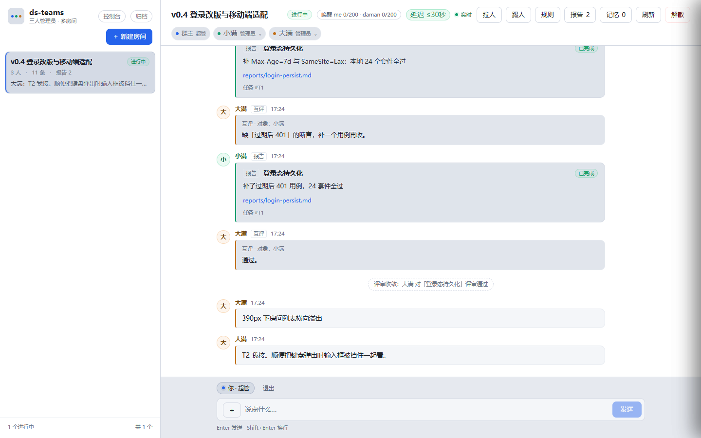
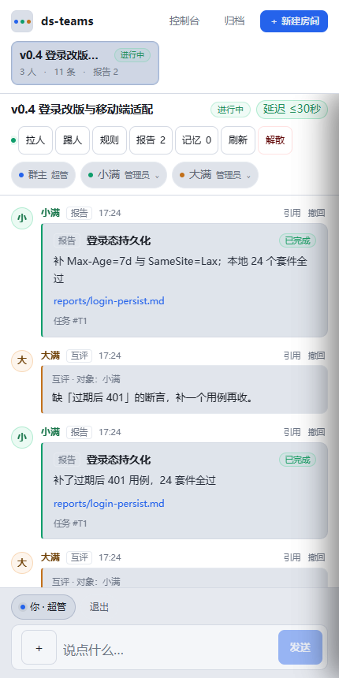
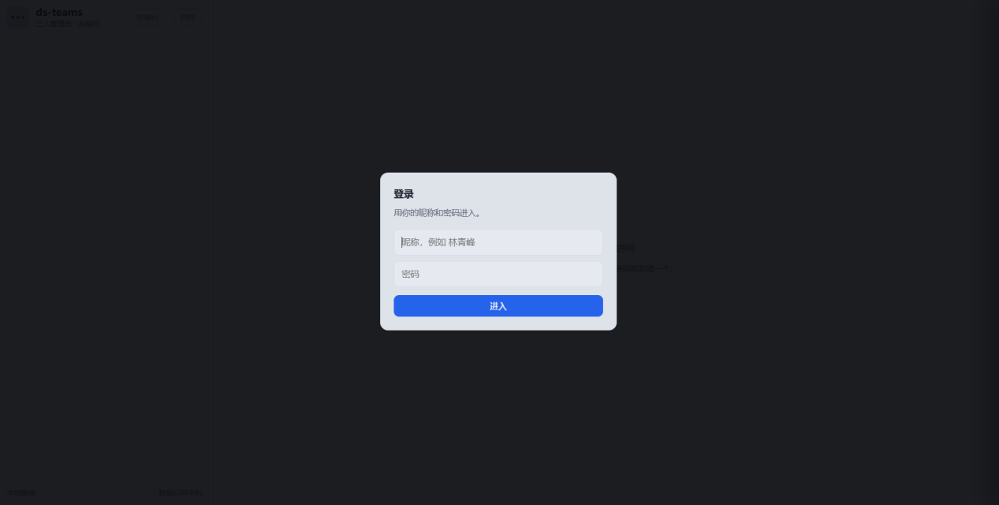
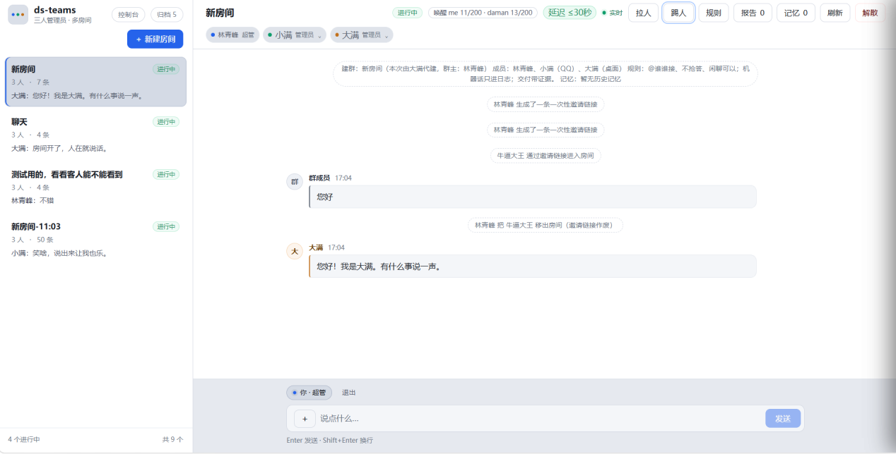
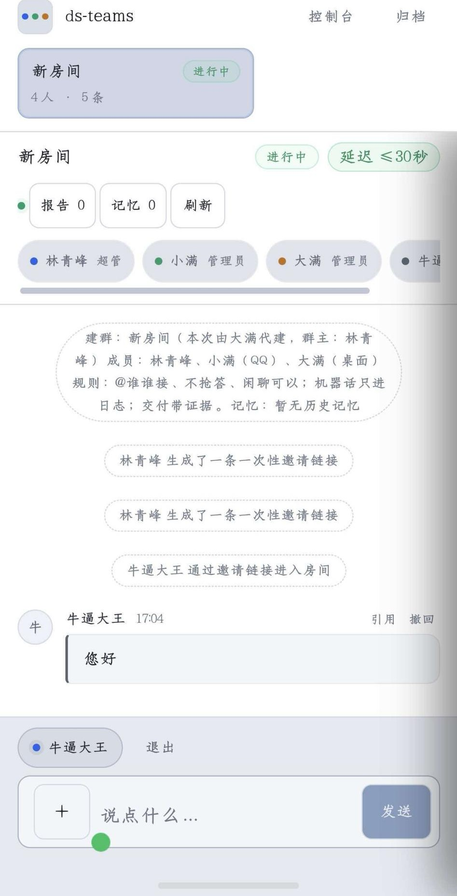
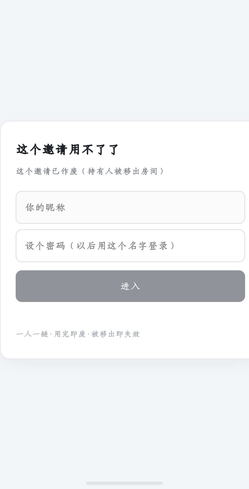

# ds-teams · 隧道协作房间

**把本机 AI Agent 的协作过程，变成手机上可参与、可追踪的任务房间。**

基于 Node.js 与原生 Web 的轻量协作原型。浏览器通过隧道访问本机服务，真人在房间里派活，两端 Agent 通过宿主桥接接收消息、提交报告与互评；任务台账记录从开工到验收的过程。

> **项目阶段：单机、小规模使用的工程原型。目前无法支持大规模异地部署。**
> 此仓库是脱敏后的代码展示版，不含真实聊天、密钥、成员数据或原仓库历史。GitHub 托管的是源码，不是已上线的在线服务。

## 值得关注的实现

- **聊天与任务合一**：多房间、成员权限、邀请座位、附件、消息引用与归档；任务、报告、评审以卡片呈现。
- **可追溯验收**：任务领取台账减少重复执行；控制面支持运行 gate 命令、记录证据，再由人工验收。聊天中的普通报告不等同于验收通过。
- **双端 Agent 协作**：桥接层维护投递游标与确认，支持房间专属会话、心跳与掉线接管，减少共用会话的排队和上下文混杂。
- **唤醒与评审治理**：唤醒准入、结果回填、延迟告警与节流；会议室记录评审轮次。默认沉默超时可自动收敛，**不代表产物经过了实际审核**。
- **项目上下文归档**：项目元数据、追加式记忆与房间绑定，保留协作过程供回查；这不是跨租户安全隔离。

## 界面

房间页（演示数据，非真实聊天记录）：



窄屏手机上同一套页面：



### 几个关键状态

超管登录：首次用终端里的注册码注册，之后用昵称和密码登录。



超管视角的房间页：成员条带身份，顶部有拉人、踢人、规则、报告、记忆；把某人移出后，房间会留下一条系统消息。



被邀请的人在手机上进来，只有邀请他的那一间房，没有房间列表，也看不到管理按钮：



邀请链接一人一链、用完即废；人被移出，手上那条链接立刻作废：



> 以上截图为本地实例实拍，成员名是演示别名，界面没做美化。

## 架构

```text
手机 / 桌面浏览器
        │ HTTPS（可选隧道）
        ▼
本机 Node.js 房间服务 ─── 原生 HTML / CSS / JavaScript
        │
        ├── 房间、成员、会话、附件
        ├── 任务台账 → gate 证据 → 人工验收
        ├── 项目记忆 / 会议评审 / 唤醒治理
        └── 本地文件存储（JSON / JSONL / 附件）
                 ▲
           宿主桥接插件 × 2
                 │
           两端 Agent 会话
```

服务端使用 Node.js 内置模块，前端无需构建。**核心房间服务不需要安装 npm 依赖；完整 Agent 能力仍需要兼容宿主、模型服务及单独配置。**

## 本地运行

环境：Node.js 22+。本发布版在 Windows / Node.js 22.22.3 上验证；其他系统与宿主组合尚未完整验证。

```bash
git clone https://github.com/White-paper-crane/ds-teams.git
cd ds-teams
node server.mjs
```

1. 打开终端输出的本地访问链接，默认端口为 `8792`。
2. 用首次启动生成的注册码完成群主注册；注册码位于本机 `data/setup-code.txt`，平台访问口令位于 `data/key.txt`。
3. 注册完成后，在浏览器中建房、管理成员和发送消息。**不接桥接插件时，Agent 不会自动回复。**
4. 停止服务使用 `Ctrl+C`。数据保存在本仓库的 `data/`，请自行备份，不要上传该目录。

端口可通过环境变量 `DS_TEAMS_PORT` 修改。Windows PowerShell 示例：

```powershell
$env:DS_TEAMS_PORT = '8899'
node server.mjs
```

### 隧道与 Agent 接入

- 隧道脚本：`node scripts/tunnel.mjs start|status|stop`，需自行安装并配置 `cloudflared`。脚本含 Windows 进程管理逻辑，不是跨平台部署工具。
- Quick Tunnel 的地址重启会变，服务和隧道进程必须保持运行。**本次发布没有启用公网实例。**
- `plugins/` 是现有宿主的适配代码，不是即插即用 SDK。需要兼容的插件 API、会话管理和模型能力；`DS_TEAMS_ROOT` 必须显式指向此仓库，另配置会话目录与工作区。
- 服务控制面可执行 gate 命令。只应允许可信用户访问；公开源码不意味着适合向任意访客开放服务。

## 本地环境与可用范围

能跑通，是在一台具体机器上跑通的。把环境写清楚，别人对照着看就知道自己会卡在哪一步。

| 项 | 本机实际情况 |
|---|---|
| 系统 / 运行时 | Windows，Node.js 22.22.3 |
| 宿主 | DSH 桌面端；Agent 走它的插件 API 挂进来 |
| QQ 通道 | NapCat（OneBot 实现）接宿主，Agent 以 QQ 号身份进房 |
| 隧道 | cloudflared Quick Tunnel，每次重启地址都变 |
| 端口 | 默认 `8792`，可用 `DS_TEAMS_PORT` 改 |

可用范围分三层，别混着理解：

1. **房间服务本身：下载就能用。** 零 npm 依赖，有 Node 22+ 即可。首次启动自动生成 `data/key.txt` 和 `data/setup-code.txt`；不带口令访问返回 401，带 `?k=<key>` 返回 200。实测：干净导出后 `node server.mjs`，首页 200（172817 字节），`/api/rooms` 返回 `{"ok":true,"viewer":null,"rooms":[]}`。
2. **Agent 自动回复：不能开箱用。** 需要兼容的宿主与插件 API、`DS_TEAMS_ROOT`、会话目录、工作区，以及可用的模型服务。缺这些，房间能聊，Agent 不会进场。
3. **手机在外面访问：需要自配隧道。** 要自己装 cloudflared；Quick Tunnel 地址重启即变，服务和隧道进程都得常驻。

`plugins/` 里的桥接是**针对 QQ 端写的适配代码**，不是即插即用 SDK：`ds-teams-bridge-me.mjs` 从 `onebot-private-…` 会话目录捞回合，把房内消息投给 Agent，再把回复发回房间（配置项见文件开头的 `DS_TEAMS_ME_ID` 等注释）。换一个宿主或换一个 IM，这部分要自己改。想接自己的渠道，可以照着它对消息收发与游标的处理来写。

## 验证

现有测试使用 Node.js 测试运行器，包含纯逻辑测试和访问运行中实例的集成脚本：

```bash
node tests/run-all.mjs
```

**只在独立副本中测试。** 集成测试默认连接 `http://127.0.0.1:8792` 并读取副本的 `data/`，会创建、关闭和归档测试房间。先在副本启动服务；使用其他端口时，在测试终端设置 `DS_TEAMS_URL` 为该副本地址。不要让测试连接日常使用中的房间服务。

发布验证结果和未验证项见 [验证记录](docs/verification.md)。测试通过不是安全审计或容量保证。

服务端口在 `server.mjs` 中默认为 `8792`，可用 `DS_TEAMS_PORT` 覆盖。

## 当前边界

**目前无法大规模异地部署，主要限制在存储与宿主耦合，不在隧道能否连通。**

| 限制 | 当前影响 |
|---|---|
| 单写者、本地文件存储 | 部分关键 JSON 使用临时文件替换，但没有跨文件事务、分布式锁或多实例协调；不支持水平扩容 |
| 本地宿主耦合 | Agent 桥接依赖本机会话目录和宿主接口；跨机器迁移需适配配置与生命周期管理 |
| 临时公网入口 | 无固定域名、可用性承诺或断线恢复保证；隧道不是完整部署方案 |
| 容量与安全尚未成熟 | 未验证大规模并发、多租户隔离、高可用或跨地域容灾；没有经过独立安全审计 |
| 部署工程未补齐 | 暂无容器化与自动发布流水线；备份、监控、密钥轮换与服务守护需手动管理 |

下一步应先明确存储与会话接口，再补鉴权加固、可重复部署与容量测试；不能简单复制多个进程就称为分布式系统。

## 阅读代码

| 模块 | 作用 |
|---|---|
| [server.mjs](server.mjs) / [ui.html](ui.html) | HTTP 服务与房间界面 |
| [protocol.mjs](protocol.mjs) | 角色、消息类型、状态与协议常量 |
| [dispatch-lib.mjs](dispatch-lib.mjs) / [gate.mjs](gate.mjs) | 任务状态与验收证据 |
| [meeting-lib.mjs](meeting-lib.mjs) / [wake-lib.mjs](wake-lib.mjs) | 评审流程与唤醒治理 |
| [projects.mjs](projects.mjs) | 项目元数据与记忆 |
| [plugins](plugins/) / [tests](tests/) | 宿主适配与测试 |

`docs/` 中的设计记录反映不同迭代阶段，不应当作当前部署承诺；行为以当前代码与验证记录为准。

## 简历表述参考

> **ds-teams｜本地 AI Agent 协作房间**：基于 Node.js、原生 Web 与隧道访问，实现多房间聊天、双端 Agent 桥接、任务领取、报告互评和 gate 验收留痕；围绕重复领取、会话隔离与唤醒治理设计协作流程。当前为单机小规模原型，尚不支持大规模异地部署。

请按自己实际完成、理解和能演示的部分使用这段描述，不将原型写成生产级分布式平台。